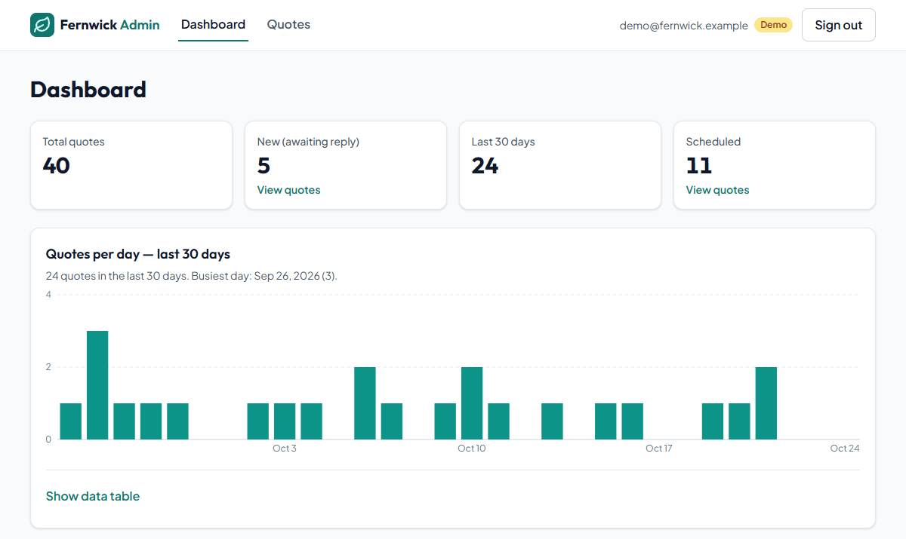
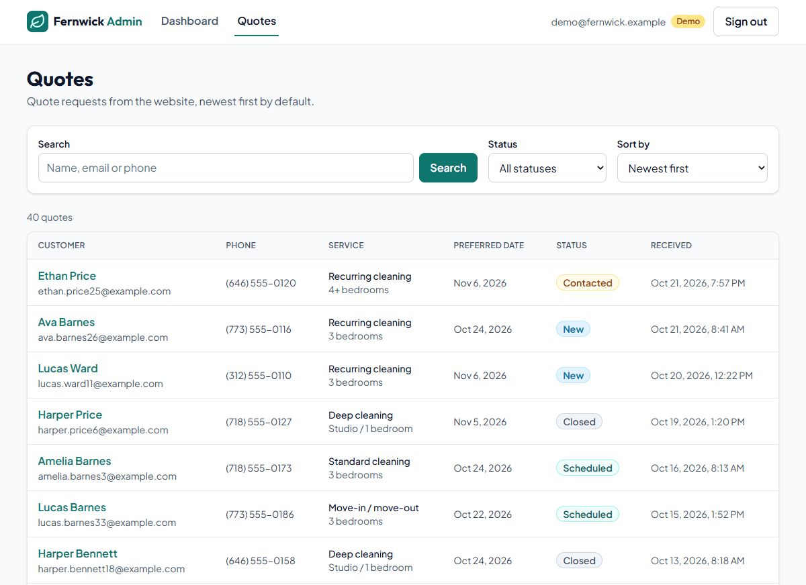
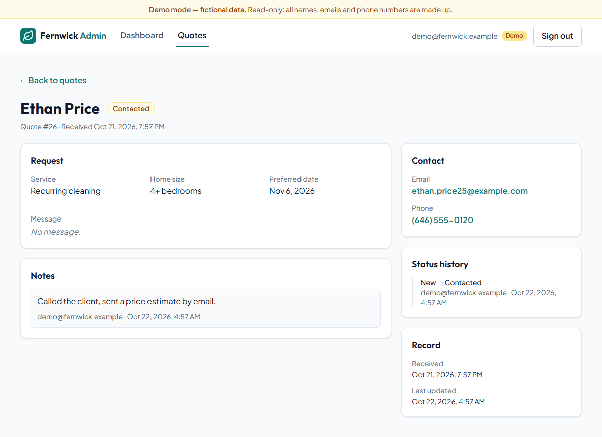
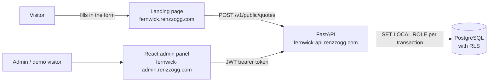

# Fernwick Platform

A full-stack quote management system for **Fernwick Home Cleaning**, a fictional cleaning business built as a portfolio project. Visitors request a quote on the marketing site, the request lands in a PostgreSQL-backed API, and the business manages it from an admin dashboard.

It is deployed and running in production. You can try it right now:

| | Link | What to do |
|---|---|---|
| **Landing page** | [fernwick.renzzogg.com](https://fernwick.renzzogg.com) | Fill in the quote form: it is sent to the live API. |
| **Admin dashboard** | [fernwick-admin.renzzogg.com](https://fernwick-admin.renzzogg.com) | Click **"View demo"**: no sign-up, no password. |

The demo account is **read-only** and only sees made-up data (40 sample quotes with notes and status history). Real quotes submitted from the landing page are invisible to it, and this is enforced by the database itself, not just by the application code (see below).

<!--
  SCREENSHOTS — replace the placeholders below with real captures and uncomment this block.
  Suggested location: docs/screenshots/

  ## Screenshots

  | Dashboard | Quote list | Quote detail |
  |---|---|---|
  |  |  |  |

  | Landing quote form | Login with "View demo" |
  |---|---|
  |  |  |
-->

## What this project demonstrates

### Security with PostgreSQL Row-Level Security

The live demo is exposed to anyone, so it has to be impossible for it to leak real customer data. Isolation is enforced in **two independent layers** (defense in depth):

- **Application layer**: every query in the service layer is scoped to the user's role, and write endpoints reject the demo account with `403` before touching the database.
- **Database layer**: the API never connects as a superuser. It runs as a least-privilege role (`fernwick_app`), and each request from a demo user switches to a read-only role (`fernwick_demo`) with `SET LOCAL ROLE`. **Row-Level Security policies** make real rows invisible to that role, and it has no `INSERT`/`UPDATE` grants at all. Even if the API code had a bug, PostgreSQL would refuse to return real rows or accept writes.
- The API **refuses to start in production** if it is configured with a database role that could bypass RLS.

### Other security measures

- Passwords hashed with **Argon2id**; stateless **JWT** authentication with role-based access (`admin` / `demo`).
- A demo user asking for a real quote gets `404`, not `403`, so it cannot even confirm that the record exists.
- Public form protected by a **honeypot** field (bots get a fake success), **per-IP rate limiting** with `Retry-After`, a 10 KB request body limit and strict input validation (unknown fields are rejected).
- Strict **CORS** allow-list, interactive API docs disabled in production, no secrets in the repository, and logs without personal data.

### Testing

- **329 automated tests** (pytest) running against a **real PostgreSQL** test database, not SQLite, because what matters most here (RLS, roles, trigram search, `generate_series`) only exists in PostgreSQL.
- Dedicated tests check that **no real data appears in any demo response** across every endpoint, filter, search, sort order and page, that roles don't "stick" to pooled connections, that migrations apply and roll back cleanly, and (with `EXPLAIN` over 20,000 rows) how RLS changes the search query plan.
- Each test runs inside a transaction that is rolled back, so tests are isolated and repeatable.

### Deployment

- Deployed on **Railway** as three services (PostgreSQL, API, static admin panel), behind **Cloudflare** with custom domains.
- Database schema managed with **Alembic** migrations, including the roles, grants and RLS policies.
- Every push to `main` deploys only the services whose files changed; the API has a health check that also verifies the database connection.
- Verified after release with a production smoke test: CORS rejection from foreign origins, `403` on forced demo writes, `429` rate limiting with the `Retry-After` header readable by the landing page, and no default Railway domain exposed.

## Tech stack

**Front end** (`admin/`)

- React 19 + TypeScript (strict mode)
- Vite
- Tailwind CSS v4
- React Router
- Native `fetch` and hand-built, accessible SVG charts (no chart or HTTP libraries)

**Back end** (`api/`)

- Python 3.14 + FastAPI
- PostgreSQL (Row-Level Security, `pg_trgm` trigram indexes)
- SQLAlchemy 2.0 + Alembic
- Pydantic v2 for validation and settings
- JWT (PyJWT) + Argon2id password hashing (pwdlib)
- pytest

**Infrastructure**: Railway, Cloudflare (DNS and proxy).

The landing page lives in a separate repository and is a static site that posts to this API.

## Architecture



- **API**: `routers → services → models`. Routers only handle HTTP concerns; business logic and queries live in services, which are testable without HTTP.
- **Database**: four tables (`users`, `quotes`, `quote_notes`, `quote_status_changes`). Status changes are written together with their history entry in a single transaction, with row locking to handle concurrent admins.
- **Admin panel**: a static single-page app. List filters live in the URL (shareable links, working back button), the session survives a page reload but not closing the tab, and the UI reacts to expired tokens and read-only accounts.
- **Endpoints**: a public form endpoint, login and demo login, quote list (filters, search by name, email or phone digits, pagination, sorting), quote detail, status updates, internal notes and dashboard metrics.

The full design document (data model, every endpoint, security decisions and trade-offs, deployment) is in [`docs/DESIGN.md`](docs/DESIGN.md) (in Spanish).

## Running locally

**Requirements**: Python 3.14, Node.js 24 + npm 11, and PostgreSQL with two databases: `fernwick` (development) and `fernwick_test` (tests).

```bash
# API
cd api
python3 -m venv .venv && source .venv/bin/activate
pip install -r requirements-dev.txt
cp .env.example .env          # then set JWT_SECRET (see the comments in the file)
alembic upgrade head          # create tables, roles and RLS policies
python -m app.cli seed-demo   # optional: sample data for the demo account
uvicorn app.main:app --reload --no-proxy-headers   # http://localhost:8000/docs

# Tests
pytest

# Admin panel (in another terminal)
cd admin
npm ci
cp .env.example .env          # VITE_API_URL=http://localhost:8000
npm run dev                   # http://localhost:5173
```

The PostgreSQL user that owns the tables needs `CREATEROLE` and `BYPASSRLS` once (the migrations create the restricted roles). The step-by-step guide, with `curl` examples for every endpoint, manual RLS checks in `psql` and all environment variables, is in [`docs/DEVELOPMENT.md`](docs/DEVELOPMENT.md) (in Spanish).

## Author

Built by **Renzzo** — [renzzogg.com](https://renzzogg.com)
