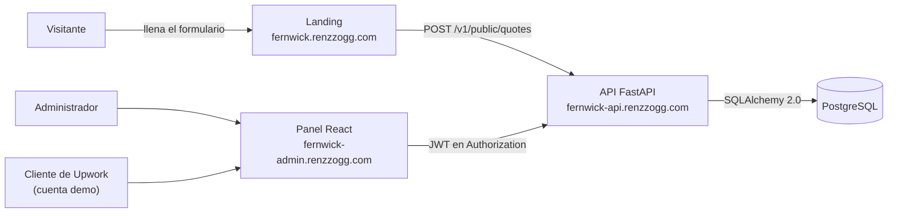
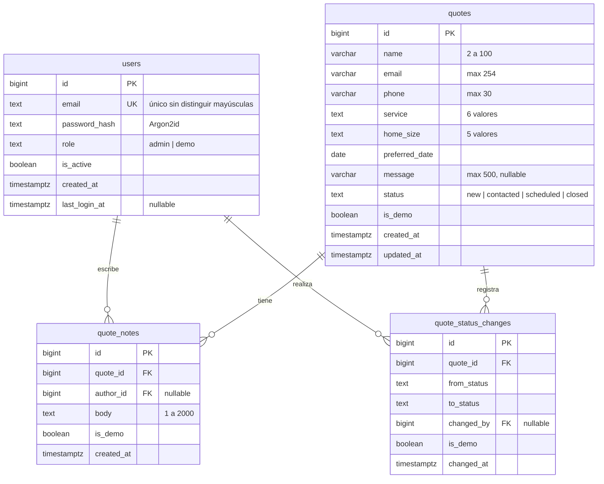
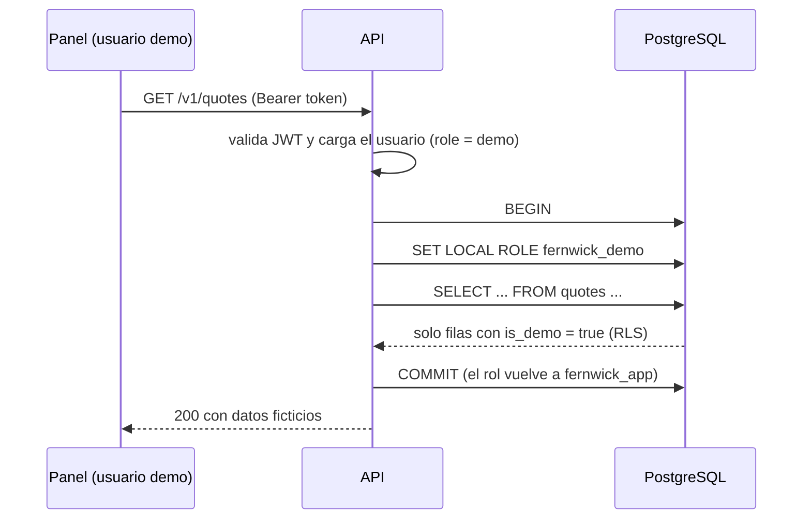

# Fernwick Platform — Documento de diseño

> Fase 0 (diseño). Este documento es la **fuente de verdad** del proyecto: si una decisión cambia durante la construcción, se actualiza aquí en el mismo commit.

Índice:

1. [Visión y alcance](#1-visión-y-alcance)
2. [Modelo de datos](#2-modelo-de-datos)
3. [Roles de base de datos y Row-Level Security (fase 6)](#3-roles-de-base-de-datos-y-row-level-security-fase-6)
4. [Endpoints de la API](#4-endpoints-de-la-api)
5. [Seguridad](#5-seguridad)
6. [Estructura del repositorio](#6-estructura-del-repositorio)
7. [Plan de fases](#7-plan-de-fases)
8. [Despliegue en Railway](#8-despliegue-en-railway)
9. [Decisiones abiertas y mejoras futuras](#9-decisiones-abiertas-y-mejoras-futuras)

---

## 1. Visión y alcance

Fernwick Home Cleaning es un negocio **ficticio** de concepto. Su landing (`~/proyectos/fernwick-home-cleaning`, en `fernwick.renzzogg.com`) ya tiene un formulario de cotización, pero hoy el envío es **simulado** (`js/main.js`). Este proyecto agrega:

- **API** (FastAPI + PostgreSQL): recibe y guarda las cotizaciones, y da servicio al panel.
- **Panel de administración** (React + Vite + Tailwind): login, lista, detalle, cambio de estado, notas internas y tablero de métricas.
- **Cuenta demo de solo lectura** para mostrar el panel en vivo a clientes de Upwork **sin exponer datos reales**.



**Fuera de alcance (v1):** envío de correos, pagos, varios negocios en la misma instalación (multi-tenant), app móvil, que el cliente final vea el estado de su cotización.

---

## 2. Modelo de datos

### 2.1 Diagrama



### 2.2 Tablas

#### `users` — quién puede entrar al panel

| Columna | Tipo | Restricciones |
|---|---|---|
| `id` | `bigint GENERATED ALWAYS AS IDENTITY` | PK |
| `email` | `text` | NOT NULL, `CHECK` de formato (ver abajo); índice único sobre `lower(email)` |
| `password_hash` | `text` | NOT NULL |
| `role` | `text` | NOT NULL, `CHECK (role IN ('admin','demo'))` |
| `is_active` | `boolean` | NOT NULL, default `true` |
| `created_at` | `timestamptz` | NOT NULL, default `now()` |
| `last_login_at` | `timestamptz` | NULL |

- **Índice único sobre `lower(email)`** (índice de expresión) y no un `UNIQUE` simple: así `Admin@x.com` y `admin@x.com` no pueden ser dos usuarios distintos, y el login busca con `WHERE lower(email) = lower(:email)` usando el índice. (Alternativa: la extensión `citext`; el índice de expresión enseña más y no necesita extensión.)
- **`is_active`** permite bloquear a alguien sin borrarlo (se conserva quién escribió cada nota).
- El usuario demo (`demo@fernwick.example`) es una fila normal con `role = 'demo'` y `password_hash = '!'`, que no es un hash válido: nadie puede entrar con contraseña. Se entra por el endpoint `/v1/auth/demo` (ver §4). Lo crea el comando `seed-demo`.

#### `quotes` — las cotizaciones

| Columna | Tipo | Restricciones |
|---|---|---|
| `id` | `bigint` identity | PK |
| `name` | `varchar(100)` | NOT NULL, `CHECK (char_length(btrim(name)) >= 2)` |
| `email` | `varchar(254)` | NOT NULL, `CHECK (email ~ '^[^@[:space:]]+@[^@[:space:]]+$')` |
| `phone` | `varchar(30)` | NOT NULL, `CHECK (char_length(regexp_replace(phone, '\D', '', 'g')) >= 10)` |
| `service` | `text` | NOT NULL, `CHECK (service IN ('standard','recurring','deep','move','office','post-renovation'))` |
| `home_size` | `text` | NOT NULL, `CHECK (home_size IN ('studio','2-bed','3-bed','4-bed','office'))` |
| `preferred_date` | `date` | NOT NULL |
| `message` | `varchar(500)` | NULL |
| `status` | `text` | NOT NULL, default `'new'`, `CHECK (status IN ('new','contacted','scheduled','closed'))` |
| `is_demo` | `boolean` | NOT NULL, default `false` |
| `created_at` | `timestamptz` | NOT NULL, default `now()` |
| `updated_at` | `timestamptz` | NOT NULL, default `now()` |

Los valores de `service` y `home_size` son **exactamente** los `value` de los `<select>` de la landing, para que no haya que traducir valores entre el formulario y la API. Los **nombres** de los campos sí difieren: el HTML usa `size` y `date`, pero la API acepta solo `home_size` y `preferred_date` (un solo vocabulario en base, API y panel, sin alias). El `fetch` de la landing (fase 9) arma el JSON con estos nombres.

#### `quote_notes` — notas internas

| Columna | Tipo | Restricciones |
|---|---|---|
| `id` | `bigint` identity | PK |
| `quote_id` | `bigint` | NOT NULL, FK compuesta `(quote_id, is_demo)` → `quotes(id, is_demo)` `ON DELETE CASCADE` (ver §2.3) |
| `author_id` | `bigint` | NULL, FK → `users(id)` `ON DELETE SET NULL` |
| `body` | `text` | NOT NULL, `CHECK (char_length(body) BETWEEN 1 AND 2000)` |
| `is_demo` | `boolean` | NOT NULL, default `false` |
| `created_at` | `timestamptz` | NOT NULL, default `now()` |

#### `quote_status_changes` — historial de estados

| Columna | Tipo | Restricciones |
|---|---|---|
| `id` | `bigint` identity | PK |
| `quote_id` | `bigint` | NOT NULL, FK compuesta `(quote_id, is_demo)` → `quotes(id, is_demo)` `ON DELETE CASCADE` (ver §2.3) |
| `from_status` | `text` | NOT NULL, mismo `CHECK` que `quotes.status` |
| `to_status` | `text` | NOT NULL, mismo `CHECK`; `CHECK (from_status <> to_status)` |
| `changed_by` | `bigint` | NULL, FK → `users(id)` `ON DELETE SET NULL` |
| `is_demo` | `boolean` | NOT NULL, default `false` |
| `changed_at` | `timestamptz` | NOT NULL, default `now()` |

No lo pide el enunciado, pero cuesta una tabla pequeña y aporta: el detalle muestra "quién cambió qué y cuándo", y es un ejemplo real de **auditoría** (nunca se borra ni se edita, solo se inserta).

### 2.3 Por qué estas decisiones

- **`bigint GENERATED ALWAYS AS IDENTITY` en vez de `serial`.** Es la forma estándar SQL y la recomendada en PostgreSQL moderno: la secuencia queda "pegada" a la columna (permisos y borrado van juntos) y `ALWAYS` impide insertar ids a mano por error. `bigint` porque cambiar de `int` a `bigint` más adelante obliga a reescribir la tabla, y el costo extra es de 4 bytes por fila.
- **¿Por qué no UUID?** Los ids no se muestran al público: el endpoint público solo devuelve el id al que acaba de crear la cotización, y todo lo demás exige login. Un UUID ocultaría cuántas cotizaciones hay, pero aquí no es información sensible y los enteros son más fáciles de leer y depurar.
- **`text` + `CHECK` en vez de `ENUM` nativo de PostgreSQL.** Agregar un valor a un `ENUM` se puede, pero **quitar o renombrar** uno no; con `CHECK`, cambiar la lista es un `DROP CONSTRAINT` + `ADD CONSTRAINT` dentro de una migración normal de Alembic. En Python sí se usan `Enum`/`Literal` para validar, así que no se pierde seguridad de tipos.
- **Restricciones repetidas en la base y en la API.** Pydantic da buenos mensajes de error al usuario; los `CHECK`/`NOT NULL` garantizan que **ningún** camino (un script, una consola `psql`, un bug) pueda guardar datos inválidos. La base es la última línea de defensa.
- **`preferred_date >= hoy` solo se valida en la API.** Un `CHECK (preferred_date >= current_date)` sería incorrecto: las restricciones deben ser verdad **siempre**, y una cotización de ayer para hoy dejaría de cumplirla mañana (además PostgreSQL exige funciones inmutables en un `CHECK`).
- **`varchar(n)` vs `text`.** En PostgreSQL rinden igual; se usa `varchar(n)` donde el límite es parte de la regla de negocio (el formulario ya limita `message` a 500) y `text` + `CHECK` donde el límite es más flexible.
- **CHECK de nombre, email y teléfono** (los mismos mínimos que valida la landing): `btrim` impide un nombre de puros espacios; la expresión regular exige `algo@algo` sin espacios, lo que también rechaza el email vacío (`NOT NULL` solo impide `NULL`, no `''`); el teléfono se cuenta solo por dígitos, así que `(212) 555-0100` es válido. Son deliberadamente simples: la validación fina (dominio del email, etc.) la hace Pydantic; la base solo impide basura evidente.
- **Convención de nombres** (`app/models/base.py`): toda restricción e índice recibe un nombre predecible (`pk_quotes`, `ck_quotes_status_valido`, `fk_quote_notes_quote_id_is_demo_quotes`, …). Sin ella, PostgreSQL inventa nombres que pueden variar entre bases, y una migración futura no sabría cómo referirse a la restricción para cambiarla. Además, el error de la base dice qué restricción falló, y las pruebas lo comprueban.
- **`timestamptz` siempre.** Guarda un instante absoluto (internamente UTC). `timestamp` "sin zona" es ambiguo y es fuente clásica de bugs. Para agrupar por día en las métricas se usa la zona del negocio (`BUSINESS_TIMEZONE`, §5.6).
- **`updated_at`** lo actualiza SQLAlchemy (`onupdate=func.now()`), no un trigger: hay un solo camino de escritura (la API) y es más fácil de seguir.
- **`email` de `quotes` no es único:** la misma persona puede pedir varias cotizaciones.
- **No se guarda la IP del visitante.** Es dato personal que no necesitamos: el límite de solicitudes vive en memoria (§5.5).
- **`is_demo` en las tres tablas de cotizaciones** y no solo en `quotes`: así la política de RLS de cada tabla es una comparación simple en la propia fila, sin subconsultas (más rápida y más fácil de razonar). La API garantiza que una nota hereda el `is_demo` de su cotización, y una restricción lo hace cumplir (ver más abajo).
- **`ON DELETE CASCADE` en notas e historial:** no tienen sentido sin su cotización. **`ON DELETE SET NULL` en autores:** si se elimina un usuario, sus notas se conservan como "autor eliminado".

Coherencia de `is_demo` entre padre e hijo, garantizada por la base con una **FK compuesta**:

```sql
-- en quotes:
ALTER TABLE quotes ADD CONSTRAINT quotes_id_is_demo_key UNIQUE (id, is_demo);
-- en quote_notes (y lo mismo en quote_status_changes):
ALTER TABLE quote_notes ADD CONSTRAINT quote_notes_quote_fk
    FOREIGN KEY (quote_id, is_demo) REFERENCES quotes (id, is_demo) ON DELETE CASCADE;
```

Así es imposible que una nota "real" quede colgada de una cotización demo o al revés.

### 2.4 Índices

| Índice | Para qué consulta |
|---|---|
| `quotes (is_demo, status, created_at DESC)` | Lista filtrada por estado y ordenada por fecha (la vista principal del panel). |
| `quotes (is_demo, created_at)` | Lista sin filtro y métricas de los últimos 30 días. |
| `quotes USING gin (name gin_trgm_ops)` y `(email gin_trgm_ops)` | Búsqueda `ILIKE '%texto%'` (extensión `pg_trgm`). |
| `quote_notes (quote_id, created_at)` | Notas de una cotización, en orden. |
| `quote_status_changes (quote_id, changed_at)` | Historial de una cotización. |
| único `users (lower(email))` | Login. |

Notas de aprendizaje:

- **El orden de columnas en un índice compuesto importa.** `(is_demo, status, created_at DESC)` sirve para `WHERE is_demo = false AND status = 'new' ORDER BY created_at DESC` sin ordenar en memoria. `is_demo` va primero porque **todas las consultas filtran por él** (en la fase 5 lo hace la capa de servicios; desde la fase 6, también la política de RLS).
- **PostgreSQL no crea índices en las FK automáticamente** (solo en PK y `UNIQUE`). Sin ellos, cada "notas de la cotización 42" y cada `ON DELETE CASCADE` recorrería toda la tabla hija. Los índices `(quote_id, …)` lo resuelven.
- **¿Por qué trigramas?** Un B-tree normal solo ayuda con `LIKE 'texto%'` (prefijo). Un índice GIN de trigramas parte el texto en grupos de 3 letras y sirve para buscar "en cualquier parte" sin recorrer la tabla. Con pocos cientos de filas PostgreSQL quizá ni lo use (un recorrido secuencial es más barato), y está bien: lo verificaremos con `EXPLAIN ANALYZE` y es la forma correcta de preparar la búsqueda para crecer.
- El teléfono se busca solo por dígitos (`regexp_replace(phone, '\D', '', 'g')`); con el volumen esperado no necesita índice.

### 2.5 Migraciones y datos demo

- El esquema lo definen los modelos de `app/models/` y lo aplica **Alembic** (`api/alembic/versions/`). La primera migración (`0001`) se generó con `--autogenerate` y se revisó a mano: se agregó `CREATE EXTENSION pg_trgm`, que autogenerate no detecta. `alembic check` confirma que modelos y base coinciden.
- `alembic/env.py` toma la URL de `app/config.py` (`DATABASE_URL`); la URL nunca se escribe en `alembic.ini`.
- **`python -m app.cli seed-demo`** es idempotente por **reinicio**: en una sola transacción crea el usuario demo si no existe (`INSERT … ON CONFLICT DO NOTHING`), borra las cotizaciones `is_demo` (el `CASCADE` arrastra notas e historial) y vuelve a crear 40 con una semilla aleatoria fija. El reparto de servicios es **realista y exacto**, no sorteado (con 40 muestras el azar podría dejar más `recurring` que `standard`): `SERVICE_WEIGHTS` en `cli.py` da 35 % standard, 25 % recurring, 20 % deep, 12 % move, 5 % office y 3 % post-renovation (14/10/8/5/2/1, repartidos con el método del mayor resto), en orden aleatorio. El servicio `office` siempre va con tamaño `office`, y los demás con un tamaño de vivienda. Servicio y tamaño usan un generador aparte, así cambiar los pesos no altera nombres, fechas ni estados. Así nunca duplica, repara datos demo alterados y recalcula las fechas respecto de hoy para que el tablero de 30 días siempre tenga datos. Las cotizaciones reales no se tocan. (Los ids demo cambian en cada ejecución: la secuencia identity no se reinicia, y no hace falta.)

---

## 3. Roles de base de datos y Row-Level Security (fase 6)

> **Cuándo se construye:** RLS y los roles `fernwick_app` / `fernwick_demo` son una **fase propia (6)**, después de tener los endpoints funcionando (fases 3–5). Así primero se aprende el modelo y la API, y después se agrega la segunda capa de defensa sobre algo que ya funciona y tiene pruebas.
>
> **Hasta la fase 6:** la API se conecta con el rol dueño de la base (en local, `renzzo`) y el aislamiento del demo depende **solo** del filtro `is_demo` que aplica la capa de servicios (cubierto por pruebas en la fase 5). Por eso **no se despliega en Railway antes de la fase 6**.

Esta es la decisión central de seguridad para la cuenta demo. La idea: **que aunque el código de la API tenga un bug, la base de datos se niegue a entregar filas reales al demo y se niegue a dejarlo escribir.** Es "defensa en profundidad": dos capas independientes.

### 3.1 Tres roles de PostgreSQL

| Rol | Puede iniciar sesión | Para qué | Permisos |
|---|---|---|---|
| Dueño (`postgres` en Railway / tu usuario local) | sí | Solo migraciones (Alembic) y seed demo | Dueño de las tablas |
| `fernwick_app` | sí | La API en tiempo de ejecución | `SELECT, INSERT, UPDATE` en las tablas; `DELETE` en ninguna; uso de las secuencias |
| `fernwick_demo` | **no** (`NOLOGIN`) | Peticiones de usuarios demo | Solo `SELECT` en las tablas de cotizaciones; `SELECT (id, email)` en `users` |

- `fernwick_app` **no** es superusuario ni tiene `BYPASSRLS` (los superusuarios y los roles con `BYPASSRLS` ignoran RLS siempre). Por eso la API **no** usa el usuario `postgres` que Railway da por defecto.
- `GRANT fernwick_demo TO fernwick_app`: la API puede "ponerse el sombrero" demo con `SET LOCAL ROLE fernwick_demo`, pero el demo no puede hacer nada que `fernwick_app` no le haya dado.
- Los roles de PostgreSQL son **del clúster**, no de una base: `fernwick` y `fernwick_test` comparten los mismos roles. La migración los crea si no existen (bloque `DO $$ … IF NOT EXISTS … $$`), **sin contraseña**; la contraseña de `fernwick_app` se pone a mano una sola vez con `ALTER ROLE fernwick_app PASSWORD '…'` y vive solo en la variable `DATABASE_URL`. Nunca en el código ni en una migración.

### 3.2 Políticas

```sql
ALTER TABLE quotes ENABLE ROW LEVEL SECURITY;
ALTER TABLE quotes FORCE ROW LEVEL SECURITY;

-- La API "normal" (admin y formulario público): solo filas reales, y solo puede crear/editar filas reales
CREATE POLICY quotes_app ON quotes FOR ALL TO fernwick_app
    USING (NOT is_demo) WITH CHECK (NOT is_demo);

-- El demo: solo lectura, solo filas demo
CREATE POLICY quotes_demo ON quotes FOR SELECT TO fernwick_demo
    USING (is_demo);
```

Lo mismo para `quote_notes` y `quote_status_changes`. Detalles:

- **RLS es "denegar por defecto":** si ninguna política aplica a un rol, ese rol ve **cero filas**. Por eso un rol nuevo no ve nada hasta que se le dé una política.
- **`USING`** filtra qué filas se pueden leer/actualizar/borrar; **`WITH CHECK`** valida las filas que se escriben. Con `WITH CHECK (NOT is_demo)`, ni siquiera un bug en la API puede crear una cotización demo desde el formulario público.
- **`FORCE`** hace que RLS aplique también al dueño de la tabla (excepto si es superusuario). Es un seguro por si algún día la API se conecta con el rol dueño por error.
- La política de `fernwick_app` no la "hereda" `fernwick_demo`: las políticas aplican al rol nombrado **y a sus miembros**, y `fernwick_demo` no es miembro de `fernwick_app` (es al revés).
- El **seed demo** lo ejecuta el dueño (superusuario en Railway, que salta RLS), así que puede insertar filas con `is_demo = true`.

### 3.3 Cómo lo usa la API en cada petición



- Una dependencia de FastAPI (`get_db_for_user`) abre la sesión de SQLAlchemy y, si el usuario es demo, ejecuta `SET LOCAL ROLE fernwick_demo` antes de cualquier consulta.
- **`SET LOCAL`** dura solo hasta el final de la transacción. Esto es clave con un **pool de conexiones**: la conexión vuelve al pool ya "limpia" y la siguiente petición (quizá de un admin) no hereda el rol demo.
- Además, la API rechaza con **403** cualquier escritura de un demo **antes** de llegar a la base. Si alguna vez falla esa capa, PostgreSQL responde `permission denied` (no hay `GRANT INSERT/UPDATE`) y la API lo convierte en 403.
- Login, `/auth/me` y el formulario público corren como `fernwick_app` (sin `SET ROLE`).

---

## 4. Endpoints de la API

Convenciones:

- Prefijo **`/v1`** para poder cambiar el contrato en el futuro sin romper la landing ni el panel.
- JSON en entrada y salida; fechas en ISO 8601 (`2026-10-20`, `2026-10-20T22:40:00Z`).
- Errores con el formato estándar de FastAPI: `{"detail": "..."}` o, en validación (422), `{"detail": [{"loc": [...], "msg": "...", ...}]}`.
- **Acceso**: *público* (sin token), *admin*, *demo* (token de usuario demo).

| Método | Ruta | Acceso | Entrada | Salida (éxito) | Errores |
|---|---|---|---|---|---|
| GET | `/health` | público | — | `200 {"status":"ok","db":"ok"}` | 503 si no hay base |
| POST | `/v1/public/quotes` | público | `{name, email, phone, service, home_size, preferred_date, message?, website?}` | `201 {"id", "created_at"}` | 422, 413, 429 |
| POST | `/v1/auth/login` | público | `{email, password}` | `200 {"access_token", "token_type":"bearer", "expires_in", "role"}` | 401, 429 |
| POST | `/v1/auth/demo` | público (si `DEMO_ENABLED`) | — | igual que login, `role: "demo"` | 404 si está desactivado, 429 |
| GET | `/v1/auth/me` | admin, demo | — | `200 {"id", "email", "role"}` | 401 |
| GET | `/v1/quotes` | admin, demo | query: `status?`, `q?`, `page=1`, `page_size=20` (máx. 100), `sort=-created_at` | `200 {"items":[QuoteSummary], "total", "page", "page_size"}` | 401, 422 |
| GET | `/v1/quotes/{id}` | admin, demo | — | `200 QuoteDetail` (con `notes` e `status_history`) | 401, 404 |
| PATCH | `/v1/quotes/{id}/status` | **solo admin** | `{"status"}` | `200 QuoteDetail` | 401, 403, 404, 409 si ya tiene ese estado, 422 |
| POST | `/v1/quotes/{id}/notes` | **solo admin** | `{"body"}` | `201 Note` | 401, 403, 404, 422 |
| GET | `/v1/metrics/summary` | admin, demo | — | `200 {"total", "by_status":{...}, "by_service":{...}, "last_30_days":[{"date","count"}]}` | 401 |

Formas de los objetos:

```text
QuoteSummary = {id, name, email, phone, service, home_size, preferred_date, status, created_at}
QuoteDetail  = QuoteSummary + {message, updated_at, notes: [Note], status_history: [StatusChange]}
Note         = {id, body, author_email | null, created_at}
StatusChange = {from_status, to_status, changed_by_email | null, changed_at}
```

Detalles de comportamiento:

- **Formulario público** (`routers/public.py` → `services/quotes.py`). Los campos se llaman igual que las columnas (`home_size`, `preferred_date`); el `fetch` de la landing los mapea desde los `name` del HTML (`size`, `date`). `website` es el **honeypot** (§5.5). El cliente **no** puede enviar `status`, `is_demo`, `id` ni fechas (422 `extra_forbidden`): el servidor fija `status = 'new'` e `is_demo = false`. La respuesta no repite los datos: el visitante ya los tiene.
- **`404` y no `403`** cuando un demo pide `/v1/quotes/{id}` de una cotización real: RLS hace que la fila "no exista" para él, y así ni siquiera se filtra que ese id existe.
- **Búsqueda `q`**: busca en nombre, email (`ILIKE`) y teléfono (por dígitos). Los parámetros siempre van como parámetros enlazados de SQLAlchemy, nunca concatenados (inyección SQL).
- **`sort`**: lista blanca (`created_at`, `-created_at`, `preferred_date`, `-preferred_date`); cualquier otro valor da 422.
- **Cambio de estado**: se permite cualquier transición (el negocio puede retroceder, p. ej. `scheduled` → `contacted`), excepto al mismo estado. Se hace en una transacción con `SELECT … FOR UPDATE` sobre la cotización para que, si dos admins cambian el estado a la vez, el historial registre el `from_status` correcto.
- **Métricas**: `by_status` y `by_service` incluyen todas las claves aunque valgan 0; `last_30_days` usa `generate_series` para que los días sin cotizaciones aparezcan con `count: 0` (si no, la gráfica tendría huecos). Los días se calculan en `BUSINESS_TIMEZONE`.
- **Documentación automática** (`/docs`, `/openapi.json`) activa en desarrollo y desactivada en producción.

---

## 5. Seguridad

### 5.1 Contraseñas

- **Argon2id** mediante la librería `pwdlib`. Argon2id es el algoritmo recomendado hoy por OWASP: es lento a propósito y usa mucha memoria, lo que encarece los ataques de fuerza bruta con GPU. Se usa `pwdlib` porque `passlib` (el clásico de los tutoriales de FastAPI) está sin mantenimiento.
- Nunca se guarda ni se registra (logs) la contraseña en texto plano. El hash incluye la sal y los parámetros.
- Si el email no existe, **igual** se verifica contra un hash falso para que el tiempo de respuesta no revele qué emails son válidos. Lo mismo pasa con un hash que no se reconoce (el `'!'` del demo): da `False` sin lanzar error y gasta el mismo tiempo. El mensaje es siempre el mismo (`"Incorrect email or password."`, en inglés como el resto de la API).
- `PasswordHash.recommended()`: Argon2id con los parámetros por defecto de argon2-cffi (`m=65536` KiB, `t=3`, `p=4`). El login usa `verify_and_update`: si algún día se suben los parámetros, el hash viejo se reemplaza por uno nuevo la próxima vez que el usuario entra, sin pedirle que cambie la contraseña.
- Código en `app/security.py`.

### 5.2 Autenticación con JWT

- Librería **PyJWT**, algoritmo **HS256**, secreto aleatorio de ≥ 32 bytes en `JWT_SECRET` (`python -c "import secrets; print(secrets.token_urlsafe(48))"`).
- `config.py` rechaza al arrancar un `JWT_SECRET` de menos de 32 bytes, y lo guarda como `SecretStr` para que no aparezca si se imprime la configuración.
- Al decodificar se fija `algorithms=["HS256"]`, así se rechazan los tokens con `"alg": "none"` (sin firma) o con otro algoritmo. Además se exigen `sub`, `role`, `iat` y `exp`. Cualquier falla (firma, vencimiento, formato, `sub` que no es número) responde **401** con `WWW-Authenticate: Bearer` y el mismo mensaje.
- Contenido del token: `sub` (id del usuario, como texto: el estándar lo exige), `role`, `iat`, `exp`. Duración: **60 minutos** (`JWT_EXPIRE_MINUTES`). Al vencer, el panel vuelve al login. Sin *refresh tokens* en v1 (más simple; ver §9).
- En **cada** petición la API decodifica el token, verifica la firma y `exp`, y **vuelve a cargar al usuario desde la base**: si se desactivó (`is_active = false`) o cambió de rol, el token deja de servir de inmediato. El rol que manda es el de la base; el del token solo lo usa el panel para pintar la interfaz.
- El panel envía el token en el header `Authorization: Bearer …` y lo guarda en memoria + `sessionStorage` (se pierde al cerrar la pestaña).
  - *Trade-off:* una cookie `httpOnly` protege mejor ante XSS (JavaScript no puede leerla), pero obliga a manejar CSRF y cookies entre subdominios. Para un panel con un solo administrador, sin HTML de usuarios renderizado sin escapar (React escapa por defecto) y con tokens de 60 minutos, el header es más simple y suficiente. Queda anotado en §9.

### 5.3 Roles de la aplicación

| Acción | admin | demo |
|---|---|---|
| Ver lista, detalle, métricas | ✅ datos reales | ✅ solo datos ficticios |
| Cambiar estado, agregar notas | ✅ | ❌ 403 |

- Implementado con dependencias de FastAPI: `current_user = Depends(get_current_user)` y `Depends(require_role("admin"))` en las rutas de escritura.
- **Cuenta demo**: `POST /v1/auth/demo` entrega un token del usuario demo **sin contraseña**. Ventaja frente a publicar "usuario: demo / clave: demo123": no existe ninguna contraseña que pueda filtrarse o reutilizarse, y se apaga con `DEMO_ENABLED=false`. Tiene su propio límite de solicitudes. El panel muestra un botón "Ver demo" en el login y un banner permanente "Modo demo — datos ficticios"; los botones de edición se ocultan (la seguridad real está en la API y en la base, la interfaz solo es cortesía).
- **Admin inicial**: se crea por consola con `python -m app.cli create-admin --email …` (pide la contraseña sin mostrarla). No se crea desde variables de entorno para no dejar una contraseña de admin guardada en Railway.

### 5.4 CORS

- `CORSMiddleware` con lista blanca en `CORS_ORIGINS`: en producción `https://fernwick.renzzogg.com` y `https://fernwick-admin.renzzogg.com`; en desarrollo `http://localhost:8000` (landing) y `http://localhost:5173` (Vite).
- Métodos `GET, POST, PATCH, OPTIONS`; headers `Authorization, Content-Type`; `allow_credentials=False` (no usamos cookies).
- `CORS_ORIGINS` se lee como texto separado por comas (`NoDecode` de pydantic-settings, para que no se interprete como JSON). Si falta, la lista queda **vacía**, es decir, ningún origen permitido, que es lo seguro. `config.py` **rechaza `*`** al arrancar.
- **CORS no es autenticación.** Solo le dice al *navegador* qué páginas pueden leer las respuestas. Un script con `curl` ignora CORS por completo; por eso las rutas privadas exigen JWT y la pública tiene honeypot y límite de solicitudes.

### 5.5 Protección contra spam y abuso

- **Honeypot**: la landing agrega un campo `website` oculto (fuera de la pantalla, `tabindex="-1"`, `autocomplete="off"`, `aria-hidden`). Las personas no lo ven y lo dejan vacío; muchos bots llenan todos los campos. Si llega con valor (sin contar espacios), la API responde **201 igual** pero **no guarda nada**: así el bot no aprende que fue detectado. La respuesta es indistinguible de una real: el `id` sale de la misma secuencia de la tabla (`nextval`, que consume un número igual que un INSERT; los huecos en los ids son normales) y `created_at` es el `now()` de la base. Todas las respuestas dan `created_at` en UTC (`Z`), nunca en la zona de la sesión de PostgreSQL. Solo se registra un log sin datos personales.
- **Límite de solicitudes** por IP, con un limitador **propio** (`app/rate_limit.py`, sin dependencias; se descartó `slowapi`, que suma 3 paquetes, tiene poco mantenimiento y obliga a recibir `request` en cada ruta):
  - `POST /v1/public/quotes`: 5 por minuto y 20 por día.
  - `POST /v1/auth/login`: 10 por minuto (frena la fuerza bruta).
  - `POST /v1/auth/demo`: 20 por minuto.
  - Responde **429** con header `Retry-After` (segundos hasta que vuelve a haber cupo).
  - Algoritmo de **ventana deslizante**: por IP se guarda un `deque` con las horas de las solicitudes **aceptadas**. Las rechazadas no se guardan, así la memoria por IP queda acotada al límite mayor y no se castiga más al que insiste. Un `threading.Lock` protege los datos porque las rutas `def` corren en varios hilos. Cada 1000 solicitudes se borran de memoria las IP inactivas.
  - Se aplica como **dependencia** de FastAPI (`Depends(rate_limit(limiter))`). FastAPI resuelve las dependencias antes de validar el cuerpo, así que las solicitudes inválidas (422) también cuentan y un bot no puede tantear gratis. Las rechazadas por tamaño (413) no cuentan: el middleware las corta antes de llegar a la ruta, y ya cuestan casi nada.
  - Se guarda **en memoria**: suficiente con una sola instancia de la API. Si se escala a varias, hace falta Redis (§9).
- **IP real detrás de los proxies** (`client_ip()` en `app/rate_limit.py`). En producción el camino es visitante → Cloudflare → proxy de Railway → API, así que la conexión TCP que ve la API siempre es la del proxy. Si se usara esa IP, todos los visitantes compartirían un solo cupo. Los encabezados que traen la IP real los puede **inventar** cualquiera que hable directo con la API, así que solo se confía en ellos si lo indica `CLIENT_IP_HEADER`:
  - `none` (por defecto: desarrollo y pruebas): IP de la conexión; se ignoran los encabezados.
  - `x-forwarded-for`: la entrada **derecha** de `X-Forwarded-For`, que es la que agregó el último proxy. La izquierda la escribe el cliente y nunca se usa. Sirve solo si hay un proxy delante (Railway sin Cloudflare).
  - `cf-connecting-ip` (**producción**): el encabezado que pone Cloudflare, que sobrescribe el que mande el cliente. Detrás de Cloudflare, la entrada derecha de `X-Forwarded-For` sería una IP de Cloudflare compartida por miles de visitantes.
  - Si el encabezado falta o no es una IP válida, se usa la IP de la conexión. La IP se normaliza (`ipaddress`) para que la misma IPv6 escrita de dos formas no tenga dos cupos.
  - Es una variable con valores fijos y no un booleano "confiar en proxies": un booleano tendría que adivinar el encabezado, y "probar uno y si no el otro" permite elegir la IP a quien llegue sin pasar por Cloudflare.
  - **Uvicorn corre con `--no-proxy-headers`**, así solo la app decide la IP. Con `--forwarded-allow-ips="*"`, Uvicorn reemplaza la IP por la entrada **izquierda** de `X-Forwarded-For`, que es falsificable. Y sin ninguna opción, confía en ese encabezado cuando la conexión viene de `127.0.0.1`, así que en local un `curl -H 'X-Forwarded-For: …'` cambiaría la IP.
  - Pendiente para la fase 10: el dominio `*.up.railway.app` llega a la API **sin pasar por Cloudflare**, y por ahí se podría falsificar `CF-Connecting-IP`. Hay que quitarlo en Railway y dejar solo `fernwick-api.renzzogg.com` con el proxy de Cloudflare activo.
  - Al rechazar una solicitud con 429 se registra un `warning` con la ruta, sin la IP.
- **Validación** con Pydantic (`schemas/quote.py`): longitudes tomadas de las mismas constantes que la tabla (`models/base.py`: nombre 2–100, email ≤ 254, teléfono ≤ 30, mensaje ≤ 500); `EmailStr` (paquete `email-validator`, sin consultas DNS); teléfono con solo dígitos, espacios y `+ ( ) - .`, y ≥ 10 dígitos; `service`/`home_size` como `Literal[*SERVICES]`/`Literal[*HOME_SIZES]` (sin copiar las listas); fecha entre hoy y hoy + 365 días en `BUSINESS_TIMEZONE` (el tope evita fechas absurdas como 9999-12-31); recorte de espacios (`str_strip_whitespace`); mensaje vacío → `NULL`; `extra="forbid"` para rechazar campos desconocidos. Mensajes de error en inglés, como la landing.
- **Tamaño del cuerpo**: un middleware ASGI propio (`app/middleware.py`) rechaza con 413 los cuerpos de más de **10 KB** (una cotización legítima ocupa < 2 KB). Si llega `Content-Length`, responde sin leer el cuerpo. Si no llega (envío por partes, *chunked*) o miente, cuenta los bytes mientras se leen y corta al pasarse. Va por dentro de CORS para que el 413 también lleve los headers CORS y la landing pueda leerlo.
- Si el honeypot y el límite no bastan, el siguiente paso es Cloudflare Turnstile (§9).

### 5.6 Secretos y configuración

- Toda la configuración se lee de variables de entorno con **`pydantic-settings`** (`app/config.py`), que valida tipos y falla al arrancar si falta algo obligatorio (mejor fallar al desplegar que a mitad de una petición).
- En local se usan archivos `.env` (en `.gitignore`, **nunca** se commitean). Se versiona `api/.env.example` y `admin/.env.example` con los nombres de las variables y valores de ejemplo, sin secretos reales.
- En Railway, las variables se definen en cada servicio.

| Variable | Servicio | Secreto | Ejemplo / descripción |
|---|---|---|---|
| `DATABASE_URL` | api | sí | `postgresql+psycopg://fernwick_app:…@host:5432/fernwick` — rol sin privilegios (hasta la fase 6: el rol dueño, que también usa Alembic) |
| `MIGRATIONS_DATABASE_URL` | api | sí | Desde la fase 6: URL del rol dueño, solo para Alembic y el seed |
| `TEST_DATABASE_URL` | api (solo local) | sí | Base de pruebas; su nombre **debe** terminar en `_test` (las pruebas la vacían) |
| `JWT_SECRET` | api | sí | ≥ 32 bytes aleatorios |
| `JWT_EXPIRE_MINUTES` | api | no | `60` (entre 1 y 1440) |
| `CORS_ORIGINS` | api | no | lista separada por comas (vacía = ninguno; `*` no se admite) |
| `DEMO_ENABLED` | api | no | `true` / `false` (por defecto `false`: el demo se activa a propósito) |
| `BUSINESS_TIMEZONE` | api | no | `America/New_York` (zona del negocio ficticio) |
| `ENVIRONMENT` | api | no | `development` / `production` (activa `/docs`, nivel de logs) |
| `CLIENT_IP_HEADER` | api | no | `none` (desarrollo) / `x-forwarded-for` / `cf-connecting-ip` (producción). De dónde sale la IP del visitante (§5.5) |
| `VITE_API_URL` | admin | **no** | `https://fernwick-api.renzzogg.com` — se incrusta en el JS en el build, así que es **pública** por definición |

- Driver de PostgreSQL: **psycopg 3** (`postgresql+psycopg://`). Railway entrega URLs `postgresql://…`; `config.py` las normaliza.
- En desarrollo local la conexión va por **socket Unix** con autenticación *peer* (sin contraseña): `postgresql+psycopg://renzzo@/fernwick?host=/var/run/postgresql`. Por TCP (`localhost:5432`) el PostgreSQL local exige contraseña.
- Errores 500 sin trazas en producción (solo un id de error; el detalle va a los logs de Railway). Los logs nunca incluyen contraseñas, tokens ni el cuerpo completo de las cotizaciones.
- **Logs** (`app/logging_config.py`, llamado desde `main.py`): se configura solo el logger `app` (todos los `logging.getLogger(__name__)` de `app.*` heredan de él), con un handler a stderr y `propagate=False`. Nivel según `ENVIRONMENT`: `DEBUG` en `development`, `INFO` en `test` y `production` (así el aviso del honeypot y los logins fallidos llegan a los logs de Railway). No se usa `logging.basicConfig` en el logger raíz: con la raíz en `INFO`, SQLAlchemy imprimiría cada consulta SQL. Uvicorn y Alembic configuran sus propios loggers.

### 5.7 Otros

- HTTPS en todos los dominios (Railway emite los certificados).
- Datos personales: las cotizaciones reales solo las ve el admin. Respaldo manual con `pg_dump` antes de cambios grandes.

---

## 6. Estructura del repositorio

```text
fernwick-platform/
├── api/
│   ├── app/
│   │   ├── main.py            # Crea la app FastAPI, middlewares (CORS, tamaño), incluye routers
│   │   ├── middleware.py      # Límite de tamaño del cuerpo (413)
│   │   ├── rate_limit.py      # Límite de solicitudes por IP en memoria (429)
│   │   ├── config.py          # Settings con pydantic-settings
│   │   ├── db.py              # Engine, sessionmaker, sesión por petición y SET LOCAL ROLE
│   │   ├── security.py        # Hash de contraseñas (pwdlib) y JWT (PyJWT)
│   │   ├── deps.py            # get_current_user, require_role, get_db_for_user
│   │   ├── models/            # Modelos SQLAlchemy 2.0 (Mapped[...]): base.py, user.py, quote.py, note.py, status_change.py
│   │   ├── schemas/           # Esquemas Pydantic de entrada/salida
│   │   ├── routers/           # health.py, public.py, auth.py, quotes.py, metrics.py
│   │   ├── services/          # Lógica de negocio y consultas (quotes.py, metrics.py)
│   │   └── cli.py             # create-admin, seed-demo
│   ├── alembic/
│   │   ├── env.py
│   │   └── versions/          # Migraciones: 0001 tablas e índices; roles y RLS en la fase 6
│   ├── tests/                 # pytest: conftest.py (BD fernwick_test), test_*.py
│   ├── alembic.ini
│   ├── requirements.txt       # Producción: versiones exactas, incluidas las transitivas
│   ├── requirements-dev.txt   # -r requirements.txt + pytest, httpx
│   ├── pytest.ini             # Configuración de pytest (no se usa pyproject.toml para no cambiar cómo Railpack instala)
│   ├── .python-version        # 3.14 (igual que en local; lo lee Railpack, que si no usaría 3.13)
│   └── .env.example
├── admin/
│   ├── src/
│   │   ├── api/               # Cliente HTTP (fetch + token)
│   │   ├── auth/              # Contexto de sesión, ruta protegida
│   │   ├── components/        # Tabla, filtros, badges de estado, banner demo, gráficas
│   │   ├── pages/             # Login, QuotesList, QuoteDetail, Dashboard
│   │   ├── main.jsx
│   │   └── index.css          # Tailwind v4 (@import "tailwindcss")
│   ├── index.html
│   ├── vite.config.js
│   ├── package.json           # Versiones exactas
│   └── .env.example
├── docs/
│   └── DESIGN.md
├── CLAUDE.md
├── README.md                  # Cómo levantar la API y correr las pruebas
└── .gitignore
```

- **routers → services → models.** Los routers solo traducen HTTP (validar entrada, códigos de estado); la lógica y las consultas viven en `services/`, que se pueden probar sin HTTP. Para un proyecto de este tamaño no se agrega una capa extra de "repositorios".
- **SQLAlchemy síncrono** (no `async`): FastAPI ejecuta las rutas `def` en un pool de hilos, el tráfico esperado es mínimo y el código síncrono es más fácil de aprender y probar. Pasar a `async` más adelante es un cambio localizado en `db.py` y los servicios.
- **Panel:** React Router para las páginas; `fetch` nativo (sin axios). Para las gráficas se propondrá una librería (p. ej. Recharts) o barras simples hechas con Tailwind; se decide en la fase 8 con aprobación, como cualquier dependencia nueva.
- **Tests de la API** contra una base PostgreSQL real `fernwick_test` (no SQLite): RLS, `pg_trgm` y `generate_series` no existen en SQLite, y lo que queremos probar es justamente eso. Cada test corre dentro de una transacción que se revierte al final.

---

## 7. Plan de fases

Cada fase termina con su verificación, un commit local y un REPORTE.

| # | Fase | Qué se construye | Se verifica |
|---|---|---|---|
| 0 | Diseño | Este documento, `CLAUDE.md`, `.gitignore` | Revisión del documento |
| 1 | Esqueleto de la API | `venv`, `requirements.txt`, `config.py`, `main.py`, `GET /health`, pytest configurado, `README.md` | `pytest` verde; `uvicorn` local y `curl localhost:8000/health` → `{"status":"ok","db":"ok"}` contra la base `fernwick` |
| 2 | Base de datos (sin RLS) | Modelos, Alembic, migración de tablas + índices, comando `seed-demo` idempotente | `alembic upgrade head` en `fernwick`; seed dos veces sin duplicar; pruebas contra `fernwick_test`: migración desde cero, restricciones que rechazan datos inválidos, relaciones y `ON DELETE` |
| 3 | Formulario público | `POST /v1/public/quotes`, validación, honeypot, rate limit, límite de cuerpo | Tests: válido → 201 y fila en BD; inválido → 422; honeypot → 201 sin fila; 6.ª petición en un minuto → 429; cuerpo grande → 413 |
| 4 | Autenticación | Hash, JWT, `login`, `demo`, `me`, `cli create-admin` | Tests: login correcto/incorrecto, token vencido o manipulado → 401, usuario desactivado → 401, demo apagado → 404 |
| 5 | Endpoints del panel | Lista con filtros/búsqueda/paginación, detalle, cambio de estado con historial, notas, métricas; filtro `is_demo` según el rol en la capa de servicios | Tests: filtros y búsqueda; demo recibe 403 al escribir; **demo nunca ve una fila real** (ni en lista, detalle ni métricas); métricas con días en cero |
| 6 | Roles y Row-Level Security | Migración con roles `fernwick_app` / `fernwick_demo`, `GRANT`s y políticas (§3); `SET LOCAL ROLE` por petición; `MIGRATIONS_DATABASE_URL` | En `psql`: como `fernwick_app` no se ven filas demo; con `SET ROLE fernwick_demo` solo se ven filas demo y un `INSERT` falla con `permission denied`; las pruebas de la fase 5 siguen en verde con la API conectada como `fernwick_app`, más pruebas de aislamiento que saltan el filtro de servicios |
| 7 | Panel I | Vite + React + Tailwind, login (incluido "Ver demo"), lista con filtro/búsqueda, detalle | Probado a mano contra la API local con admin y con demo; `npm run build` sin errores |
| 8 | Panel II | Cambiar estado, agregar notas, tablero de métricas, banner y modo demo | Flujo completo admin; con demo no hay botones de edición y la API rechaza escrituras forzadas |
| 9 | Conectar la landing | (Repo `fernwick-home-cleaning`) `fetch` real a la API, campo honeypot, manejo de errores 422/429 | Enviar desde la landing local → aparece en el panel local; subir `?v=` del JS según sus reglas |
| 10 | Despliegue | Servicios de Railway, variables, dominios, migraciones, admin y seed en producción | Prueba de humo: `/health`, cotización desde `fernwick.renzzogg.com`, login admin, demo sin datos reales, CORS desde un origen no permitido falla |

---

## 8. Despliegue en Railway

### 8.1 Servicios (un proyecto de Railway, monorepo)

| Servicio | Origen | Configuración |
|---|---|---|
| **Postgres** | Plantilla PostgreSQL de Railway | Volumen persistente. Elegir la versión mayor más cercana a la local (PostgreSQL 18) y verificar compatibilidad con `pg_trgm`. |
| **api** | Este repo, *Root Directory* `api/` | Railpack (Python). Start: `uvicorn app.main:app --host 0.0.0.0 --port $PORT --no-proxy-headers` (la IP real la decide la app según `CLIENT_IP_HEADER`, §5.5). *Pre-deploy command*: `alembic upgrade head` (si la migración falla, no se publica la versión nueva). *Healthcheck*: `/health`. *Watch paths*: `api/**`. |
| **admin** | Este repo, *Root Directory* `admin/` | Railpack (Node) con `npm ci` + `npm run build`, servido como sitio estático con Caddy: `RAILPACK_SPA_OUTPUT_DIR=dist`, `RAILPACK_NODE_NPM_INSTALL=npm ci` (igual que la landing). *Watch paths*: `admin/**`. `VITE_API_URL` definida antes del build. |

- **Watch paths** evitan que un cambio solo en `admin/` vuelva a desplegar la API y viceversa.
- Un push a `main` despliega ambos servicios automáticamente (lo hace el usuario, nunca Claude).

### 8.2 Variables

- **api**: `MIGRATIONS_DATABASE_URL=${{Postgres.DATABASE_URL}}` (variable de referencia: Railway la mantiene actualizada si cambian credenciales). `DATABASE_URL` se arma a mano con el rol `fernwick_app` y el host interno de Railway (`${{Postgres.PGHOST}}`, `${{Postgres.PGPORT}}`, `${{Postgres.PGDATABASE}}`); el tráfico API ↔ base va por la **red privada** de Railway (sin costo de salida y sin exponer la base a internet). Resto: `JWT_SECRET`, `JWT_EXPIRE_MINUTES`, `CORS_ORIGINS`, `DEMO_ENABLED`, `BUSINESS_TIMEZONE`, `ENVIRONMENT=production`, `CLIENT_IP_HEADER=cf-connecting-ip`.
- **admin**: `VITE_API_URL=https://fernwick-api.renzzogg.com`, `RAILPACK_SPA_OUTPUT_DIR=dist`, `RAILPACK_NODE_NPM_INSTALL=npm ci`.

Primer despliegue (una sola vez): tras la migración, poner la contraseña de `fernwick_app` (`ALTER ROLE` desde `psql` con la URL del dueño), luego `railway run python -m app.cli create-admin` y `railway run python -m app.cli seed-demo`.

### 8.3 Dominios

- En Railway: *Settings → Networking → Custom Domain* en cada servicio: `fernwick-api.renzzogg.com` (api) y `fernwick-admin.renzzogg.com` (admin).
- En el DNS de `renzzogg.com`: un registro `CNAME` por subdominio apuntando al destino que muestra Railway (y el `TXT` de verificación si lo pide). Railway emite el certificado HTTPS.

### 8.4 Consumo esperado

Railway cobra por uso real (RAM, CPU, disco, salida de red). Estimación con el tráfico de un portafolio (decenas de visitas al día):

| Servicio | RAM típica | Costo aprox./mes |
|---|---|---|
| api (Uvicorn, 1 worker) | 100–150 MB | US$ 1.0–1.5 |
| Postgres | ~100 MB + volumen < 1 GB | US$ 1.0–1.2 |
| admin (Caddy estático) | ~20 MB | US$ 0.2 |
| CPU (casi siempre ociosa) y red | — | < US$ 0.5 |
| **Total adicional** | | **≈ US$ 2–4 / mes** |

Calculado con tarifas de referencia (≈ US$ 10 por GB de RAM al mes, ≈ US$ 20 por vCPU al mes, ≈ US$ 0.15 por GB de volumen, ≈ US$ 0.05 por GB de salida). El plan Hobby incluye US$ 5 de uso al mes, compartidos con la landing (~US$ 0.2–0.5), así que debería entrar en lo incluido. **Antes de desplegar hay que confirmar las tarifas vigentes en railway.com/pricing** y poner una alerta/límite de gasto en el panel de Railway.

Para ahorrar se podría activar que la API "duerma" cuando no tiene tráfico, pero la primera petición tardaría varios segundos en despertar: mala impresión en una demo en vivo para un cliente. Se recomienda no activarlo.

---

## 9. Decisiones abiertas y mejoras futuras

- **Refresh tokens** o cookie `httpOnly` si el panel tiene más usuarios o sesiones largas.
- **Notificación por email** al admin cuando llega una cotización (p. ej. con un proveedor transaccional).
- **Cloudflare Turnstile** en la landing si el honeypot y el límite no frenan el spam.
- **Redis** para el límite de solicitudes si la API pasa a tener más de una instancia.
- **SQLAlchemy 2.1**: ya existe; se empezó con 2.0.x (lo que define el stack). Migrar es un cambio de versión, con el mismo estilo de código 2.0.
- **`httpx2`**: Starlette avisa que `TestClient` con `httpx` está obsoleto y sugiere `httpx2`; cambiarlo cuando sea estable (requiere aprobar la dependencia).
- **Restablecer los datos demo** periódicamente (hoy no hace falta: el demo no puede escribir).
- **Exportar a CSV** y paginación por cursor si el volumen crece.
